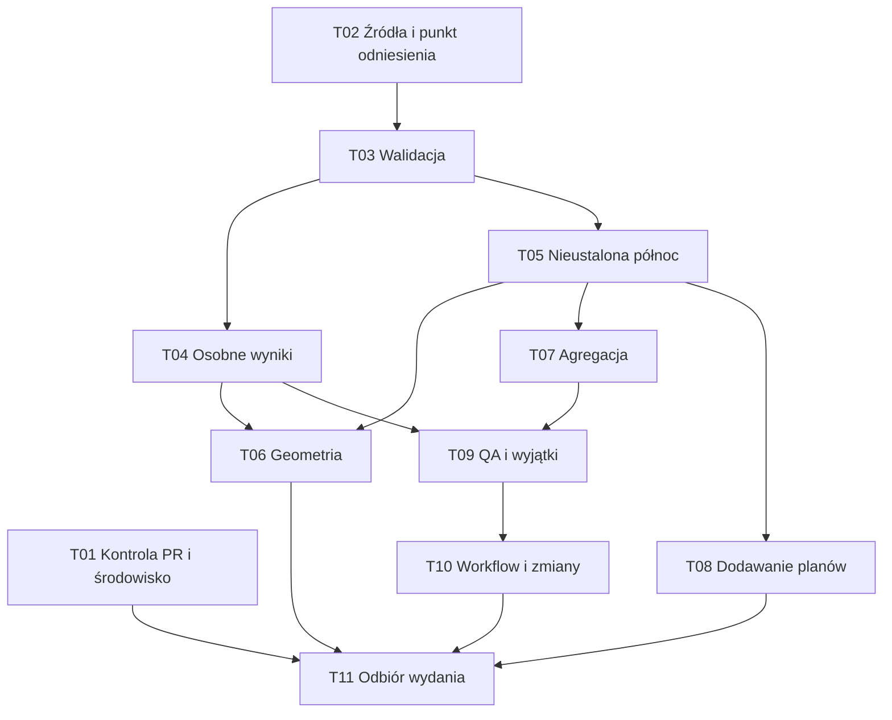

# Jakość danych i CI — podział prac

Status: podział i zależności zaakceptowane. Zadania T01–T11 opublikowano 24 października 2026 jako GitHub Issues #6–#16, z 14 natywnymi relacjami „blocked by” i etykietą `ready-for-agent`. Etykieta oznacza przygotowanie zadania; rozpoczęcie pracy wymaga ukończenia jego zależności.

Punkt odniesienia przeglądu: `fad70f09992671a0da5a364dfea4a2c538f80e3d` z 24 października 2026. Katalog obejmuje 814 planów: 801 z crowdsourcingu i 13 dodanych ręcznie. Liczby opisują ten stan, a nie stały limit katalogu.

## Cel i zaakceptowane decyzje

Pierwszy etap dostarcza sprawdzany pipeline, odtwarzalne wyniki oraz jawną listę planów wymagających interpretacji. Nie wymaga pełnej weryfikacji kartograficznej wszystkich planów.

1. Znane, opisane niepewności mogą pozostać w wydaniu. Nowe błędy techniczne i nowe nieudokumentowane odstępstwa blokują kontrolę.
2. Te same wejścia i środowisko mają dawać identyczne TFW oraz zgodną geometrię i zdekodowane piksele TIFF. Identyczność binarna ZIP pozostaje poza tym etapem.
3. Plan z nieustalonym rodzajem północy zachowuje dotychczasową orientację z jawnym statusem niezweryfikowanej. Poprawiona matematyka jest stosowana po ustaleniu rodzaju północy.
4. Generowanie pozostawia źródłowe YAML-e i obrazy bez zmian. Wyniki są zapisywane osobno; CI nie dopisuje commitów bota do `main`.
5. Zadania i ich stan są prowadzone w GitHub Issues. Specyfikacja, decyzje i instrukcje agentów są wersjonowane w repozytorium.
6. Każda korekta orientacji ma uzasadnienie oraz porównanie przed i po. Ręczne korekty i surowe źródła są zachowywane przy migracjach.

## Reguły odbioru wspólne dla zadań

- Jedno zadanie oznacza samodzielnie weryfikowalny rezultat. Domyślnie powstaje osobny PR; konflikt w tym samym module może wymagać kolejności prac mimo braku zależności funkcjonalnej.
- Każda naprawa ma test zachowania, który ujawnia usterkę przed poprawką i przechodzi po niej. Test nie kopiuje wzoru z implementacji jako swojego wzorca poprawności.
- Test zgodności z wynikiem historycznym chroni kompatybilność; nie nadaje temu wynikowi statusu poprawnego geodezyjnie.
- Zmiana danych zawiera listę zmienionych planów i pól oraz przyczynę. Zmiany położenia, orientacji i skali są raportowane oddzielnie.
- Każdy PR aktualizuje dotyczącą go instrukcję, przechodzi wspólną komendę kontroli i niezależne review względem kryteriów zadania.
- Błędy struktury, niepoprawne liczby, brak wymaganych wejść i uszkodzone wyniki nie podlegają wyjątkowi QA. Wyjątek może dotyczyć określonej niepewności interpretacyjnej.
- Surowe dane crowdsourcingowe pozostają niezmienione. Czyszczenie odbywa się w jawnej, odtwarzalnej warstwie klasyfikacji i agregacji.

## Zależności

T01 i T02 mogą rozpocząć się niezależnie. Zależności w tabeli są warunkami rozpoczęcia implementacji danego zadania; nie trzeba czekać na niezwiązane zadania o niższym numerze.

| ID | Rezultat | GitHub Issue | Bezpośrednie zależności |
| --- | --- | --- | --- |
| T01 | Wspólna kontrola PR i przypięte środowisko | [#6](https://github.com/dlubom/Georeferencer/issues/6) | brak |
| T02 | Przypięte współrzędne i trwały punkt odniesienia | [#7](https://github.com/dlubom/Georeferencer/issues/7) | brak |
| T03 | Walidacja danych i jednoznaczne źródło współrzędnych | [#8](https://github.com/dlubom/Georeferencer/issues/8) | [T02 / #7](https://github.com/dlubom/Georeferencer/issues/7) |
| T04 | Generowanie do osobnego katalogu z kontrolą GeoTIFF | [#9](https://github.com/dlubom/Georeferencer/issues/9) | [T03 / #8](https://github.com/dlubom/Georeferencer/issues/8) |
| T05 | Jawna niepewność północy i zachowanie orientacji historycznej | [#10](https://github.com/dlubom/Georeferencer/issues/10) | [T03 / #8](https://github.com/dlubom/Georeferencer/issues/8) |
| T06 | Poprawna geometria dla ustalonego rodzaju północy | [#11](https://github.com/dlubom/Georeferencer/issues/11) | [T04 / #9](https://github.com/dlubom/Georeferencer/issues/9), [T05 / #10](https://github.com/dlubom/Georeferencer/issues/10) |
| T07 | Kontrolowana korekta agregatów crowdsourcingowych | [#12](https://github.com/dlubom/Georeferencer/issues/12) | [T05 / #10](https://github.com/dlubom/Georeferencer/issues/10) |
| T08 | Bezpieczne dodawanie planu i wybór obrazu | [#13](https://github.com/dlubom/Georeferencer/issues/13) | [T05 / #10](https://github.com/dlubom/Georeferencer/issues/10) |
| T09 | Aktualne QA i egzekwowalny rejestr wyjątków | [#14](https://github.com/dlubom/Georeferencer/issues/14) | [T04 / #9](https://github.com/dlubom/Georeferencer/issues/9), [T07 / #12](https://github.com/dlubom/Georeferencer/issues/12) |
| T10 | Przełączenie workflow i generacja według zmian zawartości | [#15](https://github.com/dlubom/Georeferencer/issues/15) | [T09 / #14](https://github.com/dlubom/Georeferencer/issues/14) |
| T11 | Odbiór wydania i odtwarzalności z czystego checkoutu | [#16](https://github.com/dlubom/Georeferencer/issues/16) | [T01 / #6](https://github.com/dlubom/Georeferencer/issues/6), [T06 / #11](https://github.com/dlubom/Georeferencer/issues/11), [T08 / #13](https://github.com/dlubom/Georeferencer/issues/13), [T10 / #15](https://github.com/dlubom/Georeferencer/issues/15) |

## Zadania i kryteria akceptacji

### T01 — Wspólna kontrola PR i przypięte środowisko

**GitHub:** [#6](https://github.com/dlubom/Georeferencer/issues/6).

**Zależności:** brak.

**Rezultat:** autor PR i agent wykonują tę samą kontrolę co CI w identyfikowalnym, odtwarzalnym środowisku.

- [ ] Jedna udokumentowana komenda uruchamia obecne 16 testów i mały test przejścia przez rzeczywisty GDAL. Celowo wprowadzona regresja powoduje niezerowy status kontroli.
- [ ] Kontrola uruchamia się dla każdego PR-a oraz pusha do `main`, również gdy zmiana dotyczy kodu, obrazu, zależności lub konfiguracji. Reguły ścieżek nie pozostawiają oczekującej obowiązkowej kontroli.
- [ ] Referencyjne środowisko Linux, Python 3.12, zależności Pythona oraz GDAL/PROJ są przypięte; wersje i sposób odtworzenia są zapisane. Lokalna komenda potrafi użyć tego samego środowiska zamiast zależeć od przypadkowego systemowego GDAL.
- [ ] Kontrola jest wymagana do scalenia przez konfigurację ochrony gałęzi lub ruleset. Aktualizacja zachowuje pozostałe istniejące zabezpieczenia.
- [ ] Instrukcja dla agentów wskazuje wspólną komendę, zakres testów i wymagane dowody w PR. Kolejne zadania rozszerzają ten sam mechanizm kontroli.

### T02 — Przypięte współrzędne i trwały punkt odniesienia

**GitHub:** [#7](https://github.com/dlubom/Georeferencer/issues/7).

**Zależności:** brak.

**Rezultat:** przyszły agent może odtworzyć, z jakich danych korzysta build, i porównać zmianę z jednoznacznym stanem historycznym.

- [ ] Wersjonowany opis wejścia wskazuje konkretny release katalogu współrzędnych, artefakt i SHA-256. Pobranie pliku o innym hashu kończy się błędem; ponowny build nie rozwiązuje automatycznie `latest`.
- [ ] Punkt odniesienia obejmuje wszystkie 814 obecnych planów, hashe źródłowych obrazów i metadanych, powiązania z otworami oraz parametry istniejących TFW. Zachowuje także ustalenia i reprodukcje review w przenośnej postaci, bez zależności od katalogów tymczasowych poprzedniej sesji.
- [ ] Zapis odróżnia istniejące wyniki historyczne od ponownego przeliczenia starszym generatorem na przypiętym CSV. Różnice po aktualizacji współrzędnych nie są przedstawiane jako wynik naprawy rotacji.
- [ ] Aktualizacja źródła współrzędnych jest jawną zmianą w PR z listą dotkniętych planów, różnicami pomiarów i raportem wpływu. Surowy snapshot jest możliwy do odzyskania, a jego hash weryfikowany.
- [ ] Odbiór nie zmienia danych wejściowych ani dotychczasowych wyników. Historyczna orientacja używana w T05 pochodzi z zapisanych TFW tego punktu odniesienia, a nie z ponownego uruchomienia znanego błędnego wzoru.

### T03 — Walidacja danych i jednoznaczne źródło współrzędnych

**GitHub:** [#8](https://github.com/dlubom/Georeferencer/issues/8).

**Zależności:** T02.

**Rezultat:** błędne lub niejednoznaczne dane są odrzucane przed rozpoczęciem generacji, a wybrane ID zawsze wskazuje rzeczywiście użyte współrzędne.

- [ ] Wersjonowany schemat sprawdza typy, pola wymagane, skończoność liczb, dodatnią skalę, zakresy współrzędnych oraz położenie kliknięcia w obrazie. Błąd wskazuje plan, pole i naruszoną regułę.
- [ ] Walidacja obrazu obejmuje dostępność, rozmiary, tryb zgodny z kompresją i zgodność identyfikacji obrazu z zadeklarowanym wejściem. Obraz podmieniony przy zachowaniu wymiarów jest wykrywany przez hash.
- [ ] Walidacja katalogu wykrywa powtórzone ID i niepoprawne liczby. Katalog może zawierać inne kategorie obiektów, ale ID wskazane przez plan musi istnieć i należeć do `jaskinia_otwor` lub `sztolnia`. Zmiana kolejności wierszy nie może zmieniać rozstrzygnięcia.
- [ ] Źródłem współrzędnych produkcyjnych jest wyłącznie jawne ID i przypięty katalog. Stare liczby lub szablon odwołujący się do innego obiektu nie mogą po cichu zastąpić jego współrzędnych. Przypadki niezgodne są odrzucane lub jawnie migrowane z raportem.
- [ ] Testy obejmują NaN/Inf, skalę zero i ujemną, brak wymiarów, niezgodny obraz, duplikaty ID, nieznane ID oraz sprzeczne lat/lon. Odrzucenie wejścia nie modyfikuje wcześniejszych artefaktów.

### T04 — Generowanie do osobnego katalogu z kontrolą GeoTIFF

**GitHub:** [#9](https://github.com/dlubom/Georeferencer/issues/9).

**Zależności:** T03.

**Rezultat:** nowy tryb generatora tworzy komplet wyników bez zapisu do danych źródłowych.

- [ ] TFW, GeoTIFF, wartości wyliczone i manifest powstają w jawnym katalogu wynikowym. Hashe źródłowych YAML-i i obrazów przed oraz po udanym i nieudanym przebiegu są identyczne.
- [ ] Geotransformacja przekazana do GDAL pochodzi z bieżącego obliczenia. Test zawiera sprzeczny stary TFW obok obrazu i potwierdza, że nie został użyty zamiast nowego wyniku.
- [ ] Odbiór rzeczywistego TIFF-a sprawdza CRS EPSG:2180, skończoną i odwracalną transformację, wymiary oraz zgodność zdekodowanych pikseli. Sam kod zakończenia GDAL nie oznacza sukcesu.
- [ ] Błąd GDAL albo kontrolnego odczytu nie publikuje częściowego wyniku jako kompletnego i nie niszczy poprzedniego poprawnego kompletu. Manifest wiąże wynik z konkretnymi wejściami i pomiarem katalogowym.
- [ ] Na niezmienionych przypadkach porównawczych nowy tryb zachowuje wynik poprzedniego generatora przy tych samych wejściach. Dotychczasowi odbiorcy pozostają obsługiwani przejściowo; wycofanie starego trybu następuje w T10.

### T05 — Jawna niepewność północy i zachowanie orientacji historycznej

**GitHub:** [#10](https://github.com/dlubom/Georeferencer/issues/10).

**Zależności:** T03.

**Rezultat:** brak wiedzy o północy jest reprezentowany jawnie i nie powoduje automatycznej zmiany orientacji planu.

- [ ] Model odróżnia północ geograficzną, magnetyczną, siatki i nieustaloną oraz pomiar 0° od przyjęcia 0°. Ustalony rodzaj ma źródło uzasadnienia; użycie deklinacji zapisuje jej wartość, konwencję znaku i podstawę, w tym datę lub epokę, gdy jest wymagana.
- [ ] Migracja obecnych planów nie ustala rodzaju północy na podstawie samego zera. Plan bez dowodów dostaje status niezweryfikowany i zachowuje kąt orientacji odzyskany z punktu odniesienia T02.
- [ ] Zachowanie orientacji historycznej nie zamraża współrzędnych otworu ani skali. Zmiany tych wielkości są osobno raportowane i nie przeliczają ukrytej korekty kierunku dla nieustalonej północy.
- [ ] Zmiana wejść określających orientację nie może po cichu odświeżyć historycznego punktu odniesienia ani nadać statusu zweryfikowanego. Wymaga jawnej decyzji z uzasadnieniem.
- [ ] Test obejmuje zgodność historycznego kąta wszystkich migrowanych planów i jawną zmianę metadanych pojedynczego planu na ustalony rodzaj północy. Generacja typu, dla którego nie ma jeszcze właściwego modelu obliczeń, kończy się błędem zamiast używać wzoru historycznego; modele dostarcza T06. Status i powód niepewności są dostępne dla QA i manifestu.

### T06 — Poprawna geometria dla ustalonego rodzaju północy

**GitHub:** [#11](https://github.com/dlubom/Georeferencer/issues/11).

**Zależności:** T04, T05.

**Rezultat:** ustalony rodzaj północy prowadzi do poprawnej geometrii potwierdzonej niezależnymi testami.

- [ ] Test kierunku północy geograficznej wykorzystuje niezależną projekcję dwóch punktów na południku, na wschód i zachód od 19° oraz na południku centralnym. Wykrywa wcześniejszy błąd znaku.
- [ ] Testy obejmują niezerowy kąt strzałki, północ siatki bez ponownej poprawki zbieżności oraz północ magnetyczną z udokumentowaną dodatnią i ujemną deklinacją.
- [ ] Rzeczywisty GeoTIFF poprawnie odwzorowuje kliknięty otwór i drugi punkt kontrolny. Konwencja narożnika i środka piksela jest jawna i zabezpieczona testem.
- [ ] Tolerancje błędu geometrii są zapisane i wynikają z zaokrągleń oraz użytej projekcji; nie są zwiększane wyłącznie w celu uzyskania zielonego testu.
- [ ] Każda zmiana rzeczywistego planu ma raport przed i po. Plany z nieustaloną północą zachowują orientację z T05; zgodność historyczna jest raportowana oddzielnie od potwierdzenia poprawnej geometrii.

### T07 — Kontrolowana korekta agregatów crowdsourcingowych

**GitHub:** [#12](https://github.com/dlubom/Georeferencer/issues/12).

**Zależności:** T05.

**Rezultat:** agregaty powstają z jawnie zakwalifikowanych obserwacji, przy zachowaniu ręcznych korekt.

- [ ] Siedem rozpoznanych rekordów TEST jest wyłączanych przez stabilne identyfikatory i zapisaną przyczynę klasyfikacji. Surowy parquet pozostaje bajtowo niezmieniony; brak przydziału sam w sobie nie jest ogólną regułą usuwania obserwacji.
- [ ] Liczby ważnych obserwacji i niezależnych użytkowników są liczone dla odpowiednich komponentów. Pomiar północy wymaga kompletnej, niezerowej strzałki; niekompletny zapis nie jest pomiarem 0°.
- [ ] Korekta czterech dotkniętych planów ma dokładny raport pól przed i po. Dla Mroźnej reprodukcja rozrzutu po wyłączeniu TEST daje około 1,16 px zamiast 7042,09 px, zgodnie z ustaloną metodą i zaokrągleniem.
- [ ] Migracja zachowuje ręczne korekty, jawne powiązania otworów i 13 planów dodanych ręcznie. Nie wykonuje pełnej ekstrakcji nadpisującej cały katalog. Niejasne pochodzenie edycji trafia do listy spraw do rozstrzygnięcia.
- [ ] Testy potwierdzają powtarzalność niezależną od kolejności obserwacji, poprawne traktowanie kątów przy granicy zakresu oraz brak cichego usuwania planu po zmianie liczby obserwacji. Wszystkie 801 historycznych grup nadal ma co najmniej pięciu nietestowych użytkowników w tym snapshotcie.

### T08 — Bezpieczne dodawanie planu i wybór obrazu

**GitHub:** [#13](https://github.com/dlubom/Georeferencer/issues/13).

**Zależności:** T05.

**Rezultat:** ręcznie dodawany plan jest jednoznacznie związany z obrazem i otworem oraz przechodzi ten sam kontrakt danych co reszta katalogu.

- [ ] Podany identyfikator obrazu rzeczywiście wybiera ten obraz. Wieloznaczność, brak wskazanego pliku lub niespójne metadane kończą się błędem; nie ma zastępstwa dowolnym TIFF-em.
- [ ] Zapis utrwala identyfikację i hash obrazu, jawne ID otworu oraz pochodzenie parametrów georeferencji. Brak wymaganych informacji nie tworzy pozornie gotowego planu produkcyjnego.
- [ ] Jawnie zaznaczone 0° nie jest utożsamiane z pominięciem pomiaru. Nowy plan z nieustaloną północą wymaga opisanej decyzji dopuszczającej i jawnie przyjętej orientacji względem siatki EPSG:2180, z konwencją oraz uzasadnieniem. Bez tego nie powstaje plan produkcyjny; nie dziedziczy on kąta ani wyjątku historycznego innego planu.
- [ ] Podgląd nie zapisuje plików. Nieudana operacja i ponowne dodanie istniejącego planu nie nadpisują jego obrazów ani ręcznych korekt.
- [ ] Testy obejmują dwa plany w jednej jaskini, obrazy o takich samych wymiarach lecz różnych hashach, brak obrazu i powtórzenie operacji. Instrukcja ręcznej pracy pokazuje pełne, poprawne wywołanie.

### T09 — Aktualne QA i egzekwowalny rejestr wyjątków

**GitHub:** [#14](https://github.com/dlubom/Georeferencer/issues/14).

**Zależności:** T04, T07.

**Rezultat:** raport jakości opisuje bieżące dane i wyniki, a CI rozróżnia dopuszczoną niepewność od nowego problemu.

- [ ] Raport obejmuje dokładny bieżący zbiór planów: początkowo 814, z rozróżnieniem crowdsourcingu i dodania ręcznego. Rozdziela brak wejścia, brak wyniku i nieaktualny wynik; nie uznaje braku artefaktów w świeżym checkoutcie za uszkodzenie źródeł.
- [ ] Raport pokazuje liczbę ważnych pomiarów północy, ich rozbieżność, źródło orientacji, stan powiązania otworu oraz wszystkie wykryte problemy, zamiast jednej odziedziczonej flagi.
- [ ] Wyjątek wskazuje konkretny plan, regułę, podstawę w danych, uzasadnienie i warunek zamknięcia. Jest związany z istotnymi wejściami; nowy problem w tym samym planie albo nieaktualne uzasadnienie nadal blokują CI.
- [ ] Uwagi z istniejących issues #1 i #3 są uzgadniane z aktualnym katalogiem. Stara uwaga nie staje się automatycznie obecnym defektem ani nowym duplikatem zadania; nierozstrzygnięte sprawy zachowują odwołanie do źródła.
- [ ] Powtórne wygenerowanie raportów daje ten sam wynik dla tych samych wejść. Testy wykazują: dopuszczenie konkretnego znanego wyjątku, odrzucenie nowego problemu i brak możliwości obejścia błędu technicznego przez rejestr wyjątków.

### T10 — Przełączenie workflow i generacja według zmian zawartości

**GitHub:** [#15](https://github.com/dlubom/Georeferencer/issues/15).

**Zależności:** T09.

**Rezultat:** lokalny i zdalny build przetwarzają właściwe plany oraz udostępniają wyniki bez zapisu do źródeł i bez commitów bota.

- [ ] Wybór zmian obejmuje cały zakres pusha lub PR-a, a nie tylko ostatni commit. Testy obejmują dodanie i usunięcie planu, zmianę obrazu, kilka commitów, ostatni commit dotyczący tylko dokumentacji oraz brak dostępnej bazy porównania.
- [ ] Aktualność wyniku wynika z zawartości wejść i wersji obliczeń. Zmiana kodu, zależności lub współrzędnych obejmuje wszystkie plany, na które może wpłynąć; niepewność zakresu powoduje pełne przeliczenie.
- [ ] Drugi przebieg bez zmian nie przelicza poprawnych, kompletnych wyników. Brakujący lub uszkodzony wynik jest odtwarzany; wymuszenie regeneracji działa. Samo mtime nie jest dowodem aktualności.
- [ ] Wszystkie workflow, raporty i pakowanie korzystają z nowego katalogu wynikowego i manifestu. Dopiero po migracji odbiorców wycofywany jest stary zapis wartości wyliczonych do źródłowych YAML-i i śledzonych TFW; historyczny punkt odniesienia pozostaje dostępny.
- [ ] CI publikuje artefakty i raporty, nie wykonuje commit/push do `main`. Standardowe generowanie pozostawia checkout bez zmian. Już przy przełączeniu publikacja tagiem i ręcznie wymaga poprawnego manifestu, dokładnego kompletu wyników i przejścia QA; brakujący, dodatkowy, nieaktualny lub powtórzony plik blokuje publikację. T11 niezależnie sprawdza te zabezpieczenia i dodaje kontrolę odtwarzalności.

### T11 — Odbiór wydania i odtwarzalności z czystego checkoutu

**GitHub:** [#16](https://github.com/dlubom/Georeferencer/issues/16).

**Zależności:** T01, T06, T08, T10.

**Rezultat:** kompletne wydanie można odtworzyć i zweryfikować na podstawie repozytorium oraz przypiętych źródeł, bez wiedzy z tej rozmowy.

- [ ] Dwa buildy w czystych katalogach, w przypiętym środowisku i z tymi samymi wejściami, dają identyczne TFW, geometrię oraz zdekodowane piksele TIFF. Różny hash ZIP-a nie powoduje błędu, jeżeli te warunki są spełnione.
- [ ] Manifest zawiera wersje kodu i schematu, hash źródła współrzędnych, wersje narzędzi, hashe wejść oraz per-plan ID obiektu i pomiaru. Wylicza dokładny komplet wyników i jawne wyjątki.
- [ ] Kontrola wydania odrzuca brakujący, dodatkowy, nieaktualny lub powtórzony plik, niepoprawną georeferencję i nowy niedopuszczony problem QA. Nie ma cichego pomijania planów.
- [ ] Publikacja jest uzależniona od tych samych bramek niezależnie od uruchomienia tagiem lub ręcznie. Próba bez publikacji potwierdza blokowanie uszkodzonej paczki i dopuszczenie kompletnej paczki ze znanymi wyjątkami.
- [ ] Niezależny agent lub reviewer odtwarza kontrolę i paczkę z czystego checkoutu, używając wyłącznie wersjonowanych instrukcji. Dokumentacja wskazuje źródła prawdy, komendy, granice automatycznych korekt i wymagane dowody; nie wymaga plików ze starej sesji.

## Zalecana kolejność pracy

Najpierw T01 i T02. Po T02 można realizować T03, a następnie równolegle przygotowywać T04 i T05. Po ich ukończeniu dostępne są niezależne zakresy T06, T07 i T08. Dalej T09, T10 i końcowy odbiór T11. Przy zmianach w tym samym module prace są scalane kolejno, a testy ponawiane dla rzeczywiście zmienionej integracji.

T01–T03 tworzą pierwszą bramkę: błędna zmiana zostaje wykryta przed generacją. T04–T09 dostarczają kontrolowany build i aktualną ocenę danych. T10–T11 kończą przejście na odtwarzalne wydanie i pracę bez mutowania źródeł.

## Powiązanie z review

| Ustalenie | Zadania |
| --- | --- |
| Znak zbieżności i niejawny rodzaj północy | T05, T06 |
| Brak testów i kontroli PR w CI | T01, T11 |
| NaN, ujemna skala i pozorny sukces GDAL | T03, T04 |
| Tryb strict nie gwarantuje źródła współrzędnych | T03 |
| Zmienny CSV, zależności i brak manifestu | T01, T02, T04, T11 |
| Rekordy TEST i niekompletne pomiary północy | T07, T09 |
| Niepełny zakres pusha i zawodny mechanizm changed | T10 |
| Ignorowane ID obrazu i dowolny TIFF zastępczy | T08 |
| Nieaktualne QA i niejawne wyjątki | T09 |
| Mutowanie YAML-i i commity generowanych wyników | T04, T10 |

Źródła zewnętrznych uwag: [Uwagi od ekipy — issue #1](https://github.com/dlubom/Georeferencer/issues/1) oraz [Weryfikacja dopasowań otworów — issue #3](https://github.com/dlubom/Georeferencer/issues/3). Obie sprawy były otwarte i nie miały komentarzy podczas sprawdzenia 24 października 2026. Ten plan nie zamyka żadnej z nich.

## Poza pierwszym etapem

- Pełna ręczna weryfikacja kartograficzna wszystkich 814 planów.
- Automatyczne uznanie nieustalonej północy za geograficzną i masowa zmiana orientacji bez podstawy.
- Naprawa deformacji skanów przez nowe modele dopasowania.
- Powrót do aktywnego crowdsourcingu i przebudowa historycznego frontendu/backendu.
- Identyczność binarna archiwów ZIP oraz automatyczne aktualizowanie źródeł do najnowszego release.

## Prowadzenie wykonania

Identyfikatory T01–T11 pozostają oznaczeniami planu i są powiązane z issues #6–#16 w tabeli powyżej. GitHub przechowuje natywne zależności i bieżący stan wykonania. Zadanie można rozpocząć po zamknięciu jego blockerów; sama etykieta `ready-for-agent` nie znosi tego warunku.

Pierwsze niezależne zadania to [T01 — #6](https://github.com/dlubom/Georeferencer/issues/6) i [T02 — #7](https://github.com/dlubom/Georeferencer/issues/7). Niniejszy dokument pozostaje opisem celu, decyzji i kryteriów, bez równoległej listy statusów wykonania.
