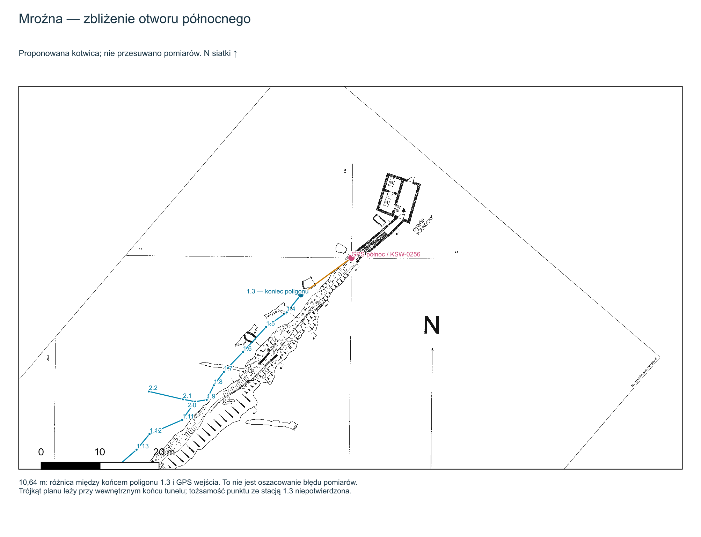

# Mroźna: poprawne przypisanie otworu północnego

Decyzja z 2026-10-26: minimalna korekta planu `001094`, `T.D-08.07`, grafika
`569`. Jedyna zmiana w `meta.yaml` to `coordinates.gps_kataster_object_id`:
`KSW-0081` → **`KSW-0256`**. Obrót, skala, kliknięcie i obraz pozostają bez zmian.

## Podstawa

Klik `(20694.01, 1732.56)` znajduje się na trójkącie `0,00` przy podpisanym
otworze północnym. Niezależny od YAML odczyt środka kropki w trójkącie daje
`(20695.1667, 1733.1667)`. Obraz ma 21954×4726 px i SHA-256
`2f58383e7a928244292b308baf0ebdf9ed3d40617f7a8da7a302c6eb1a842171`.

W przypiętym GPS Kataster v1.3.2 `KSW-0256` oznacza północne wejście na
trasę turystyczną, a dotychczasowe `KSW-0081` — południowe wyjście.
Identyfikacja dotyczy wyboru otworu, nie dokładności jego współrzędnych.

Zbliżenie dokumentuje również pozostającą rozbieżność 10,64 m między
północnym GPS a końcem poligonu. Tożsamość kropki ze stacją `1.3` oraz
dokładne położenie fizycznego punktu GPS wymagają dalszej weryfikacji.

## Zakres i QA

Zmiana daje wyłącznie translację w EPSG:2180: **+228,369999 m E,
+270,700000 m N**, razem **354,162881 m**. Współczynniki `A/D/B/E` i kąt
TFW T02 `49,343018824°` są identyczne. `north.reference=unknown`,
`orientation.status=unverified`, skala `59,03 px/m`, historyczne TFW
i źródła pozostają bez zmian.

Usunięto wyłącznie obserwację i wyjątek `001094 / entrance.review`, ponieważ
rozstrzygnięto wybór północnego otworu. Snapshot źródłowego issue #3 pozostaje
historyczny. Pozostałe pięć jego dopasowań nie jest przedmiotem tej zmiany.
Ponownie oceniono jedynie `001094 / orientation.unknown`: dowody nie zmieniły
się, a nowa podstawa QA uwzględnia poprawiony YAML i rekord współrzędnych.
Nie nadano statusu zweryfikowanej orientacji.

Deklinację, niepewną datę, asymetrię odczytów przód/tył i różnice położenia
GPS zapisano w [issue #32](https://github.com/dlubom/Georeferencer/issues/32).
Nie wprowadzono obrotu wynikającego z hipotezy magnetycznej ani zmiany
pomiarów, daty, skali czy punktu kliknięcia.

## Kontrola

Test `tests/test_mrozna_anchor.py` mapuje niezależnie odczytaną kropkę
północnego trójkąta na współrzędne KSW-0256. Przed poprawką zawodził
z odległością 354,143378 m; po poprawce daje 0,022126 m i przechodzi próg 0,05 m.
Próg sprawdza zgodność obrazu i kotwicy, nie terenową dokładność GPS.
Niezależny przegląd porównał wszystkie sekcje YAML, macierz przed/po,
hash obrazu i zakres zmian obu rejestrów QA.

Wygenerowano również osobny GeoTIFF planu 001094 z kontrolnym odczytem
generatora: CRS EPSG:2180, transformacja, wymiary i piksele PASS. Lokalnie
użyto narzędzi GDAL dostarczonych z QGIS; pełny katalog ocenia CI w
przypiętym środowisku.

Lokalne `./scripts/check`: 7 testów hostowych PASS; Docker nie odpowiedział
w ciągu 40 s, więc pełna kontrola kontenerowa wymaga wyniku CI bieżącej
rewizji. Środowisko hosta nie zastępuje przypiętego Linux/Python 3.12/GDAL.
