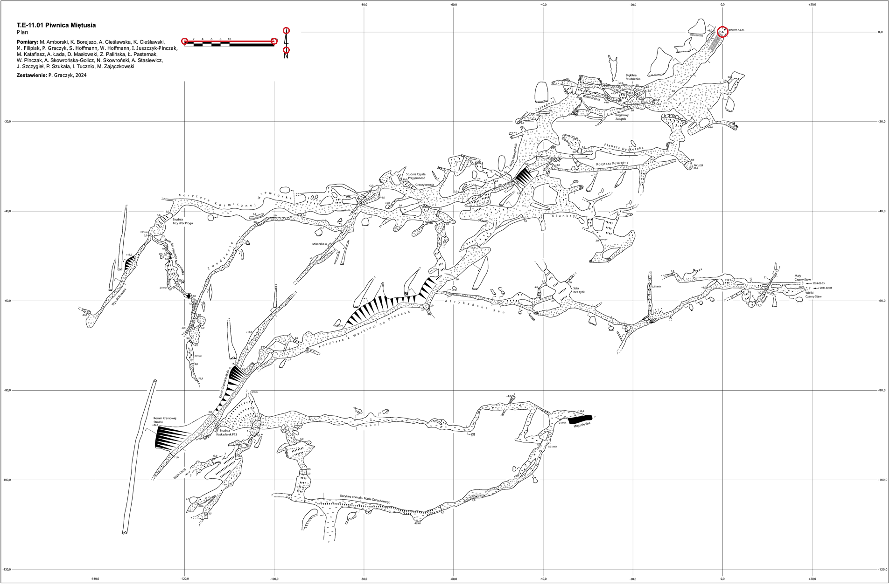

# Piwnica Miętusia — dodatkowy plan z publikacji PZA

Dodano `001459-pza-2024`, rzut poziomy ze strony 17
[Polish Caving 2017–2025](https://pza.org.pl/wp-content/uploads/2025/07/POLISH-CAVING-2017-2025.pdf#page=17).
Podpis rysunku: **Zestawienie: P. Graczyk, 2024**. Publikacja pochodzi z 2025 r.
Artykuł na stronie 16 osobno wspomina aktualizację długości do 2940 m;
nie utożsamiamy tej liczby z zakresem rysunku podpisanego 2024.

## Obraz i tożsamość

| Parametr | Historyczny `001459` | Nowy `001459-pza-2024` |
| --- | --- | --- |
| Wymiary mono | 2122 × 1628 | 7630 × 5020 |
| Skala | 38,64 px/m | 38,45 px/m |
| Piksel terenowy | około 2,588 cm | około 2,601 cm |
| Format | TIFF 1-bit | TIFF 1-bit, CCITTFAX4 |
| Kotwica | MTZ-0017 | MTZ-0017 |
| Źródłowa jaskinia | PIG 001459 | PIG 001459 |

Większe wymiary wynikają z większego zasięgu rysunku. Rozdzielczość terenowa
różni się o około 0,49%. Wycięto całą ramkę górnego planu wraz z tytułem,
autorami, siatką i legendą. Przekrój W–E z dolnej części strony nie jest
georeferencjonowany. PDF zawiera rysunek wektorowy, więc raster 1100 dpi
powstał przez bezpośrednie renderowanie, bez AI i interpolacyjnego powiększania
niskiej jakości skanu.

`image_upscaled.jpg` to kolorowy raster w wymiarach TIFF-a.
`image_original.jpg` to jego podgląd 3815 × 2510 (relacja 1:2 jak w katalogu),
**nie skan źródłowy CBDG**. Dokładne pochodzenie, hash całego PDF-u, kadr,
próg binaryzacji i pomiary zapisano w
[`source.json`](../../data/caves/001459-pza-2024/source.json).

ID obrazu `20250017` ma jawną przestrzeń `local:pza-polish-caving` i spełnia
liczbowy kontrakt schematu v1; **nie jest graphics_id PIG/CBDG**.
Dlatego nie tworzono fikcyjnego wpisu JSONL dla CLI `05_add_cave.py`.
Plan przygotowano w prywatnym stagingu i odebrano tymi samymi funkcjami
T03/T04 (`validate_plan`, `accept_generation`), po czym opublikowano katalog
przez `publish_directory` bez zastępowania celu. Ma własny
`image-identity.json` i początkową decyzję T08; nie zmieniono rejestru T02/T03.

## Własne pomiary na nowym obrazie mono

Układ narożnika rastra: x w prawo, y w dół, środek pierwszego piksela (0,5; 0,5).

- Otwór: **(6194,5; 275,5)**, środek trójkąta na przecięciu siatki 0/0,
  obok strzałki i opisu „1396,0 m n.p.m.”. Wysokość z podpisu nie zastępuje
  żadnego pomiaru katalogu współrzędnych.
- Skala: **769 px / 20 m = 38,45 px/m**, końce (1582,5; 353,5) i
  (2351,5; 353,5). Niezależnie: 3075 px między liniami siatki -80 i 0
  odpowiada 80 m, czyli 38,4375 px/m (różnica około 0,033%).
- Północ: pionowa oś N, od (2455,5; 430,5) do (2455,5; 260,5), **zmierzone 0°**.
  Mierzono oś strzałki, nie skośny bok półgrota.



Kotwica: przypięty gps-kataster **v1.3.2**, obiekt **MTZ-0017**,
pomiar **m-002**; zgodne nazwa, numer T.E-11.01 i PIG 1459.
Nie zmieniano pinu współrzędnych.

## Jawna niepewność orientacji

Samo „N” nie dokumentuje rodzaju północy. `north.reference=unknown`,
`angle_origin=measured`, `angle_deg=0`, `orientation.status=unverified`.
Nie przenoszono kliknięć ani historycznej orientacji T02 starego obrazu.

Dla nowego planu jawnie przyjęto kierunek N jako geograficzny i obrót
**+0,679677158507°** względem wschodniej osi EPSG:2180:
zmierzone 0° + zbieżność PROJ w MTZ-0017, zgodnie ze znakiem T06.
Jest to `assumed_grid`, a nie dowód rodzaju północy. Brak podstawy do
poprawki magnetycznej. Zapisano jeden konkretny wyjątek QA
`orientation.unknown`, z aktualną podstawą, źródłem i warunkiem zamknięcia:
potwierdzenie autora, jawna decyzja i ponowny odbiór. Nie odświeżano starych
wyjątków. Przy samym przyjęciu północy siatki różnica na odległości 160 m
wyniosłaby około 1,90 m; nie jest to oszacowanie pełnej niepewności planu.

## Odbiór i dowody

- T03 i rzeczywisty T04: PASS; odczyt GDAL/Pillow, EPSG:2180, jeden bit,
  CCITTFAX4, zgodne wymiary i wszystkie zdekodowane piksele.
- Niezależny odczyt `gdalinfo` i zastosowanie geotransformacji do pomiarów:
  podziałka ma 19,999999973 m, błąd numeryczny kotwicy około 0,000000403 m.
  To tolerancje obliczeń, nie dokładność terenowa GPS ani interpretacji otworu.
- Trzy testy `tests/test_piwnica_pza_plan.py`: PASS. Sprawdzają tożsamość
  publikacji, rozmiary, geometrię niezależnych punktów i zachowanie niepewności.
- Kontrolowana regresja: skala × 1,1 w kopii pamięciowej powoduje błąd testu
  podziałki (18,18 m zamiast 20 m). Źródła nie były mutowane.
- `./scripts/check` uruchomiono lokalnie: 7 testów hostowych PASS,
  po 35 s oczekiwania na nieodpowiadający Docker przerwano lokalne wywołanie.
  Pełny odbiór w przypiętym Linux/Python 3.12/GDAL potwierdza CI tego PR-a.
- Lokalny macOS: Python 3.9.6, GDAL 3.13.3, pyproj 3.6.1/PROJ 9.3.0.
  Do odbioru użyto wspólnej bazy `/opt/homebrew/share/proj`, ponieważ
  starsza baza pyproj nie identyfikuje nowego opisu ETRF2000-PL z GDAL.
  Nie zmieniano zależności ani walidatora projektu.
- Stary lokalny stos pandas/numpy/pyarrow daje już na bazowym `b905a70`
  12 blokad QA: sześć nieaktualnych podstaw i sześć niepewności trzech planów
  `004073`, `004446`, `011046`. Nie aktualizowano tych wyjątków na podstawie
  niereferencyjnego środowiska; kontrola CI pozostaje rozstrzygająca.

Wyniki niezależnego odczytu i regresji:
[`2026-10-29-piwnica-mietusia-pza-validation.json`](2026-10-29-piwnica-mietusia-pza-validation.json).
Stary katalog `001459` pozostał bajtowo bez zmian. Zmiana dodaje jeden plan
(814 → 815) i jeden przejrzany wyjątek; nie zmienia pomiarów innych planów.

## Odtworzenie rastra i generacji

Pobierz wskazany PDF i sprawdź SHA-256
`42d71568af15ded62ad3e3f6cb5f1fd3535d118506d35fe3589e1e89cd2ffe14`.

```sh
pdftoppm -f 17 -l 17 -r 1100 -x 855 -y 733 -W 7630 -H 5020 \
  -png -singlefile POLISH-CAVING-2017-2025.pdf /tmp/piwnica-plan
```

```python
from PIL import Image
im = Image.open('/tmp/piwnica-plan.png').convert('RGB')
im.convert('L').point(lambda p: 255 if p >= 200 else 0, mode='1').save(
    '/tmp/piwnica-image.tif', compression='group4', dpi=(1100, 1100))
```

Bajty rastra zależą od wersji renderera/fontów; zmiana renderowania wymaga
nowych kliknięć i nowej decyzji, a nie automatycznej aktualizacji hasha.
Standardowa generacja z zapisanych, zweryfikowanych źródeł:

```sh
./scripts/check
./scripts/build generate --changed
./scripts/build report --run-dir /build/geotiff/current --require-results
```
